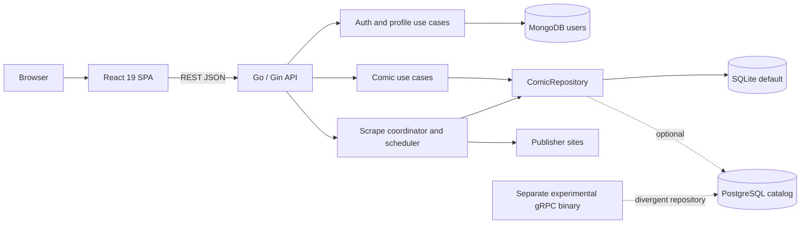
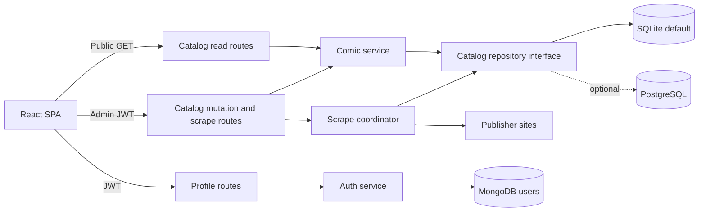
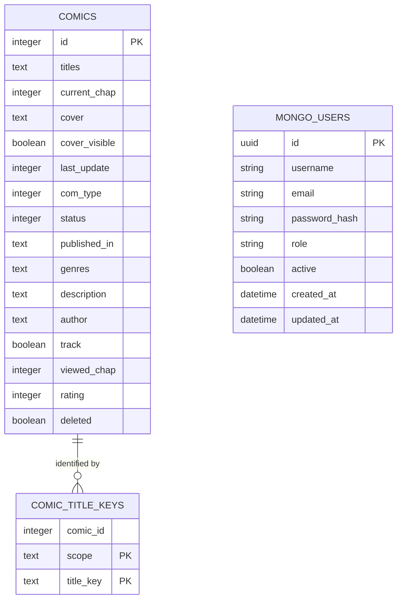
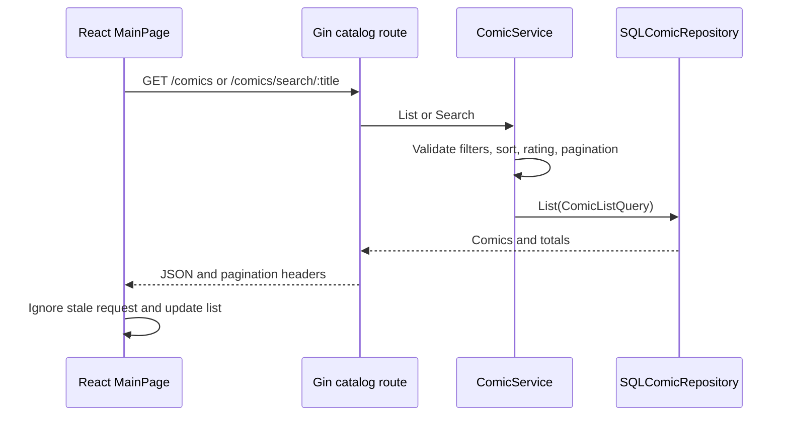
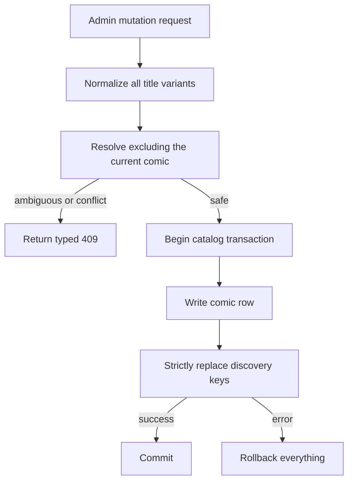
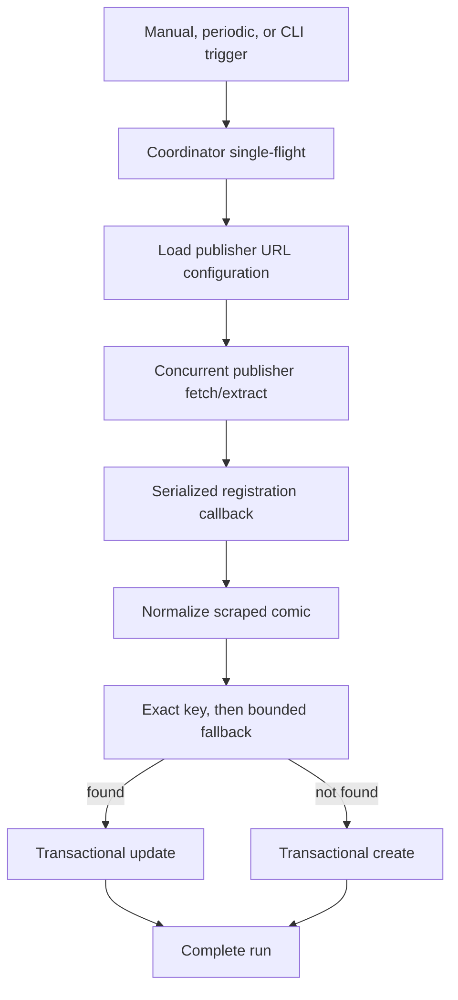

# Comics Tracker


A full-stack comic and novel tracker with a React SPA, Go/Gin API, SQLite or
PostgreSQL catalog storage, MongoDB-backed users, and native multi-publisher
scraping.

> [!IMPORTANT]
> This document distinguishes **current behavior** from the **approved target**.
> The target work is planned but not yet implemented. In particular, catalog
> mutations and manual scraping are currently public; do not expose the API to
> untrusted traffic until the security-boundary plan is complete.

## Quick Start

Prerequisites: Go 1.27.3+, Node.js 22+, npm, SQLite CLI, Docker for local MongoDB,
and `protoc` when regenerating protocol bindings.

```sh
make setup
cp go_server/local.env go_server/.env
make doctor

# Go API + Vite in the background
make dev-up
make dev-status

# Logs and shutdown
make dev-logs
make dev-down

# Release-path checks
make check
```

Run `make` or `make help` for the grouped target list. Use
`make help TARGET=go-run` for target-specific guidance.

## Architecture at a Glance

### Current Runtime



| Component | Responsibility | Primary location |
|---|---|---|
| React SPA | Routing, catalog UI, auth/profile UI, filters, pagination, mutations | `src/frontend/` |
| Go HTTP process | Bootstrap, REST, scheduler, lifecycle | `go_server/cmd/server/` |
| Route layer | Gin routes, middleware, CORS, health, auth policy | `go_server/api/` |
| Use cases | Catalog, auth, user, merge, scrape orchestration | `go_server/internal/usecase/` |
| Catalog persistence | Shared SQLite/PostgreSQL repository | `go_server/internal/repo/comics/` |
| User persistence | MongoDB users | `go_server/internal/repo/mongo/` |
| Discovery | Identity normalization and candidate resolution | `go_server/internal/identity/`, `go_server/internal/discovery/` |
| Scraper | Fetch, extract, normalize, register, schedule | `go_server/internal/scrape/` |
| Operations | Make, Docker, Render, CI/CD, backup/restore | `Makefile`, `Dockerfile`, `.github/`, `docs/` |

Production uses REST JSON. The separate gRPC binary and its PostgreSQL-only
repository do not share the production use-case/repository path and should be
treated as experimental until the contract-cleanup decision is executed.

### Approved Target Boundaries

SQLite + MongoDB remain the default. PostgreSQL remains an optional catalog
backend and future scale-up path.



Target policies:

- Catalog list/get/search remain public.
- Create, update, delete, merge, cover mutation, scrape trigger, and operational
  scrape status require an authenticated admin.
- SQLite mode runs exactly one API replica and one scheduler.
- PostgreSQL may support multiple replicas only after database-backed scrape
  coordination is enabled.
- REST is the production application contract.

The full approved design is in
[`docs/superpowers/specs/2026-10-26-architecture-review-redesign.md`](docs/superpowers/specs/2026-10-26-architecture-review-redesign.md).

## Data Architecture

### Ownership

- **SQLite** is the default canonical comics catalog.
- **PostgreSQL** is an optional catalog adapter and import target.
- **MongoDB** is the canonical user/auth store.
- **`db/comics.json` is not a runtime database or current backup source.**
- The SQLite `users` table is legacy; the reviewed database contains no rows in
  it.

### Catalog Schema



`comics.titles`, `published_in`, and `genres` are pipe-delimited values in the
current schema. `last_update` is stored as an epoch integer by the production
repository.

`comic_title_keys` stores one normalized key per title variant:

- `scope`: `series` or `novel`
- `title_key`: lowercased, leading-article-stripped, punctuation-free match key
- primary key: `(scope, title_key)`
- lookup index: `comic_id`

PostgreSQL declares `comic_id REFERENCES comics(id) ON DELETE CASCADE`.
SQLite's runtime-created table currently lacks that foreign key.

### Verified Local Catalog Snapshot

Read-only audit on 2026-10-26:

| Check | Result |
|---|---:|
| `PRAGMA integrity_check` | `ok` |
| Total comics | 31,309 |
| Active comics | 31,308 |
| Discovery-key rows | 31,892 |
| Active comics without keys | **346** |
| Keyless rows whose key is owned by another active comic | 341 |
| Unicode-only key candidates | 4 |
| Empty-title blocked records | 1 (`id=4561`) |
| Orphan key rows | 0 |

The current `INSERT OR IGNORE` / `ON CONFLICT DO NOTHING` behavior means the
unique key table can silently reject a second owner while leaving the second
comic row active and keyless. This is why a key-collision audit can report zero
groups while duplicate/keyless records still exist.

### Required Catalog Invariants

The approved target requires:

1. Every active comic has at least one valid discovery key.
2. One `(scope, title_key)` has exactly one active owner.
3. A key conflict returns a typed error; it is never silently ignored.
4. Comic and title-key writes commit or roll back together.
5. Create, update, merge, import, and scrape use the same title normalization
   and duplicate policy.
6. Deleted comics do not retain keys that block active records.
7. SQLite and PostgreSQL pass the same repository contract suite.

## Critical Application Flows

### Catalog Read



The frontend debounces search, aborts superseded reads, and silently refreshes
every three minutes while visible and online.

### Catalog Write

Current create flow:

1. Validate and normalize title variants.
2. Resolve every incoming title against existing comics.
3. Insert the comic.
4. Delete/reinsert discovery keys.

Steps 3 and 4 are not atomic for ordinary REST writes unless the caller has
already opened a transaction. Update also does not currently normalize edited
titles or re-run duplicate detection.

Target flow:



### Merge

`ComicService.Merge` currently:

- opens one catalog transaction,
- reads the canonical and duplicate rows,
- unions titles/publishers/genres,
- keeps maximum current/viewed chapters,
- ORs tracking,
- keeps the higher rating,
- updates the canonical row,
- hard-deletes the duplicate.

The target adds normalization and explicit key-conflict handling before commit.

### Scrape



Current behavior:

- Asura, ManhuaPlus, FlameScans, RealmScans, DemonicScans, and Manganato are
  supported.
- Most publisher URLs fetch concurrently.
- Manganato pages run sequentially to share Cloudflare cookies.
- Catalog registration is serialized.
- Each registered comic uses its own transaction.
- Overlapping runs in one process are rejected.
- Publisher failures are logged and suppressed, so a run can report success
  despite partial or total fetch failure.

The coordinator is process-local. It is sufficient only for one replica.

### Authentication

1. Password login reads the Mongo user and compares bcrypt hashes.
2. The server issues HMAC-signed access and refresh JWTs.
3. Profile middleware accepts bearer or cookie access tokens.
4. The frontend stores the access token in `sessionStorage`.
5. Catalog requests currently do not attach that token.

Approved hardening includes Mongo uniqueness, active-user enforcement,
server-trusted role lookup, rotating refresh sessions, per-request OAuth state,
PKCE, and verified Google email.

### Startup and Shutdown

Current startup:

1. Load environment.
2. Initialize logging.
3. connect/ping MongoDB.
4. open SQLite or PostgreSQL catalog.
5. create scrape coordinator and comic service.
6. mount routes and start periodic scraping.
7. run Gin.

Current shutdown closes repositories after receiving a signal but does not use
`http.Server.Shutdown`, stop accepting requests first, or explicitly drain an
active scrape.

## Algorithm Reference

### Identity Normalization

`go_server/internal/identity/identity.go`:

- normalizes smart apostrophes and whitespace,
- strips `(novel)` / `- novel`,
- stores titles in sentence case,
- removes leading `the`, `a`, or `an` from match keys,
- removes non-ASCII-alphanumeric match characters,
- scopes keys as `series` or `novel`,
- extracts significant tokens for reordered-title matching.

Complexity is O(total title characters). The ASCII-only key and permissive
single-token fallback are known edge cases.

### Discovery Resolution

`go_server/internal/discovery/resolver.go`:

1. Normalize the incoming title.
2. Query indexed discovery keys.
3. If not resolved, choose a significant word and query up to 200
   `%token%` key candidates.
4. Filter by exact key, prefix, or significant-token relation.
5. Score candidates.

Current score:

| Signal | Score |
|---|---:|
| Exact normalized key | +10 |
| Exact stored text ignoring case | +5 |
| Significant-token relation | +8 |
| Prefix relation | +6 |
| Tracked comic | +2 |
| Chapter tie-break contribution | `current_chap / 100` |

The minimum accepted score is 6; equal scores prefer the lower comic ID. The
target removes user-progress signals from identity decisions and returns an
explicit ambiguous result for close candidates.

### Discovery-Key Synchronization

`SyncDiscoveryKeys` deletes a comic's existing keys, deduplicates its variants
in memory, and inserts every scoped key. Complexity is O(title variants).
Current conflicting inserts are silent; the target makes them typed failures.

### Dedupe

`go-dedupe` currently audits key collision groups, selects the lowest ID as
canonical, exports `approved: false`, and applies only approved merges.

Because unique-key losers have no key row, current audit alone cannot find the
346 keyless comics. The approved plan adds a read-only keyless/conflict export,
review signals, fingerprints, backup validation, canary application, and
explicit operator decisions. It does not bulk auto-merge the catalog.

### Scrape Concurrency

Fetch work is concurrent by publisher/URL, with selected sequential publishers.
Registration is serialized and each comic is transactional. Planned retries
apply only to typed transient network failures with bounded backoff; parser,
configuration, and database failures are not retried.

### List, Search, and Pagination

The backend clamps limits to 100, validates rating bounds and sort columns, and
uses offset pagination. Active/update and tracked/update indexes support common
list paths. `%term%` title search can scan the table.

The frontend page size is calculated from viewport columns and estimated rows.
The approved target resets the offset when page size changes to avoid empty or
misaligned pages.

## Security Model

### Current

- Catalog reads: public
- Catalog writes: public
- Merge: public
- Manual scrape and scrape status: public
- Profile: JWT-protected
- Dashboard: JWT + admin role
- Metrics and Swagger: public

### Approved Target

- Catalog list/get/search: public
- Profile: authenticated user
- Catalog create/update/delete/merge/cover mutation: authenticated admin
- Manual scrape/status/history: authenticated admin
- Metrics/Swagger: protected, disabled, or network-restricted in production

Frontend role checks only hide controls. Backend middleware remains the
authorization boundary.

## Operations

### Common Make Targets

| Area | Targets |
|---|---|
| Setup | `setup` (includes `setup-go`, `setup-front`, `proto-go`, `setup-hooks`), `doctor` |
| Full stack | `dev-up`, `dev-down`, `dev-status`, `dev-logs`, `dev-restart` |
| Frontend | `front-dev`, `front-dev-https`, `front-test`, `front-build`, `front-deploy` |
| Go | `go-run`, `go-scrape`, `go-test`, `contract-test`, `go-vet`, `go-build` |
| Catalog | `go-dedupe`, `go-db-maint`, `go-import-postgres` |
| Database | `db-check`, `db-reindex`, `db-backup`, `db-restore` |
| Quality | `check-go`, `check-front`, `check` |
| Docker | `docker-build`, `docker-run`, `docker-dev`, `docker-down` |
| Protobuf | `proto-go`, `proto-js` |

### Local URLs

- Frontend: `http://localhost:3000/comics/`
- Go API: `http://localhost:8081` or local TLS when configured
- Liveness: `/health`
- Readiness: `/ready`
- Catalog-only DB health: `/health/db`

### Database Safety

```sh
# Verify integrity
make db-check

# Create db/backups/comics_backup_<timestamp>.db
make db-backup

# Audit title-key collision groups
make go-dedupe ARGS="--audit"

# Export a review plan
make go-dedupe ARGS="--export-plan db/recovery/merge-plan.json"

# Offline legacy-column maintenance; back up first
make go-db-maint ARGS="--drop-legacy-identity-key"
```

Restore only while the API is stopped:

```sh
make dev-down
make db-restore BACKUP=db/backups/comics_backup_<timestamp>.db
make db-check
```

`db-restore` copies a SQLite `.db` backup. It does not rebuild from
`db/comics.json`.

### SQLite Deployment Constraint

SQLite mode is intentionally single-instance:

- one writable database file,
- one API process,
- one periodic scheduler,
- one process-local scrape coordinator.

Do not increase Render replica count or run a second scheduled API against the
same catalog. Use PostgreSQL plus database-backed scrape coordination before
horizontal scaling.

### Render

Use the root Dockerfile:

- Runtime: Docker
- Dockerfile: `Dockerfile`
- Build context: repository root
- Persistent disk: `/data`
- Catalog path: `/data/comics.db`
- Health path today: `/health`; approved lifecycle work changes deployment
  gating to `/ready`
- Do not set `HTTP_PORT`; Render supplies `PORT`

Required environment includes MongoDB, JWT secrets, `HOST_URL`,
`ENVIRONMENT=production`, and the GitHub Pages CORS origin.

See [`docs/deploy-render.md`](docs/deploy-render.md).

### CI and Deployment

Current CI runs:

- Go tests
- Go vet
- Go server/scrape builds
- golangci-lint
- frontend tests
- frontend production build

Current CI does not run the repository contract target, Docker build, migration
rehearsal, or post-deploy readiness smoke. The SSH deployment workflow also
does not take a catalog backup or explicitly depend on CI success. These are
covered by the lifecycle and verification plans.

## Critical Findings

### P0

1. Catalog mutation, merge, and scrape endpoints are public.
2. Silent discovery-key conflicts have left 346 active comics without keys.
3. Title-changing updates do not normalize or run duplicate checks.

### P1

1. REST comic/key writes are not atomic.
2. Scrape can report success when publishers fail.
3. HTTP and active scrape work are not gracefully drained.
4. Production deployment uses liveness instead of datastore readiness.
5. Mongo uniqueness and active-user enforcement are incomplete.
6. OAuth state and verified-email handling require hardening.
7. SQLite cannot support multiple API replicas.

### P2/P3

- SQLite/PostgreSQL schema and migration paths drift.
- REST and gRPC use divergent repositories.
- Frontend mutations may fail silently or drift from list state.
- MongoDB is ephemeral in the default root Compose stack unless Atlas is used.
- Python-era, JSON-backup, generated protobuf, and legacy schema references
  obscure the supported runtime.

## Improvement Roadmap

Each plan is test-driven and contains exact files, interfaces, commands,
expected outcomes, migration/rollback steps, and commit boundaries.

1. **[Security boundary](docs/superpowers/plans/2026-10-26-security-boundary.md)**
   - Benefit: closes public destructive/expensive operations.
   - Cost: frontend session/error UX and coordinated deployment.

2. **[Discovery and data integrity](docs/superpowers/plans/2026-10-26-discovery-data-integrity.md)**
   - Benefit: repairs keyless records and prevents silent recurrence.
   - Cost: 341 historical owner conflicts require human review.

3. **[Transactional repository and schema parity](docs/superpowers/plans/2026-10-26-transactional-repository-schema-parity.md)**
   - Benefit: atomic writes and one SQLite/PostgreSQL contract.
   - Cost: offline SQLite schema migration and rehearsal.

4. **[Lifecycle and operations](docs/superpowers/plans/2026-10-26-lifecycle-operations.md)**
   - Benefit: graceful deploys, readiness gating, verified recovery.
   - Cost: longer deployment workflow and bounded drain delay.

5. **[Scrape reliability](docs/superpowers/plans/2026-10-26-scrape-reliability.md)**
   - Benefit: truthful outcomes, bounded retries, cancellation and history.
   - Cost: larger status contract and longer transient-failure runs.

6. **[Authentication hardening](docs/superpowers/plans/2026-10-26-auth-hardening.md)**
   - Benefit: trusted roles, unique users, rotating sessions, safe OAuth.
   - Cost: one-time session invalidation and Mongo migration.

7. **[Frontend API consistency](docs/superpowers/plans/2026-10-26-frontend-api-consistency.md)**
   - Benefit: one typed client, no silent mutation success, canonical refresh.
   - Cost: touches every frontend network call.

8. **[Contract and legacy cleanup](docs/superpowers/plans/2026-10-26-contract-legacy-cleanup.md)**
   - Benefit: one understandable production contract and repository path.
   - Cost: removal is breaking if the consumer gate finds a real gRPC client.

9. **[Observability and verification](docs/superpowers/plans/2026-10-26-observability-verification.md)**
   - Benefit: measurable invariants and release gates across every workstream.
   - Cost: additional CI and telemetry maintenance.

The ordered plan index is
[`docs/superpowers/plans/README.md`](docs/superpowers/plans/README.md).

## Testing

```sh
make go-test
make contract-test
make front-test
make check-go
make check-front
make check
```

Focused suites live alongside their packages/components. PostgreSQL integration
tests are optional today; the repository-parity plan makes them a required CI
matrix.

## Deployment

### Frontend

The Vite app uses the `/comics/` base path for GitHub Pages.

```sh
make front-build
make front-deploy
```

Important frontend variables:

- `VITE_API_SERVER`: preferred production/local API base
- `VITE_GO_API_TARGET`: local Vite `/api` proxy target
- `VITE_PY_SERVER`: legacy fallback scheduled for cleanup

### Go API

```sh
make docker-build
docker run --rm -p 8081:8081 \
  --env-file go_server/.env \
  -v "$PWD/db:/data" \
  comics-go-api
```

For production, provide secrets through the platform or an ignored environment
file. Do not deploy the placeholder secrets in `go_server/local.env`.

## Repository Layout

```text
.
├── config/                    Publisher URL configuration
├── db/                        SQLite catalog, JSON legacy export, backups
├── docs/                      Deployment, design specifications, plans
├── go_server/
│   ├── api/                   Gin routes, middleware, controllers
│   ├── bootstrap/             Environment and application composition
│   ├── cmd/                   Server, scrape, dedupe, maintenance tools
│   ├── domain/                Entities and interfaces
│   ├── internal/
│   │   ├── discovery/         Resolver and match ranking
│   │   ├── identity/          Title normalization and discovery keys
│   │   ├── repo/              Mongo and SQL adapters
│   │   ├── scrape/            Native publisher scraping
│   │   └── usecase/           Application rules
│   └── pkg/pb/                Generated Go protobuf code (experimental)
├── proto/                     Experimental protobuf definitions
├── src/frontend/              React application
├── dev/                       Local stack tooling
├── Dockerfile                 Production Go image
└── Makefile                   Canonical developer command surface
```

## Further Documentation

- [Approved architecture review](docs/superpowers/specs/2026-10-26-architecture-review-redesign.md)
- [Implementation plan index](docs/superpowers/plans/README.md)
- [Render deployment](docs/deploy-render.md)
- [Go service details](go_server/README.md)
- [Local proxy and stack](dev/README.md)
- [Scrape coordination design](docs/superpowers/specs/2026-10-08-scrape-coordination.md)
