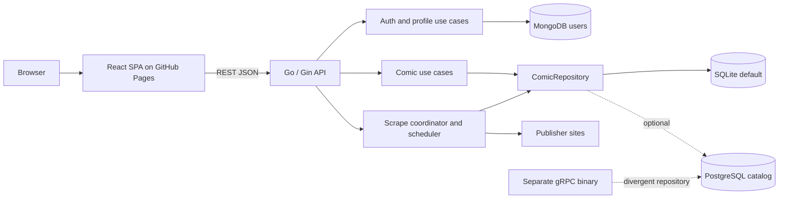
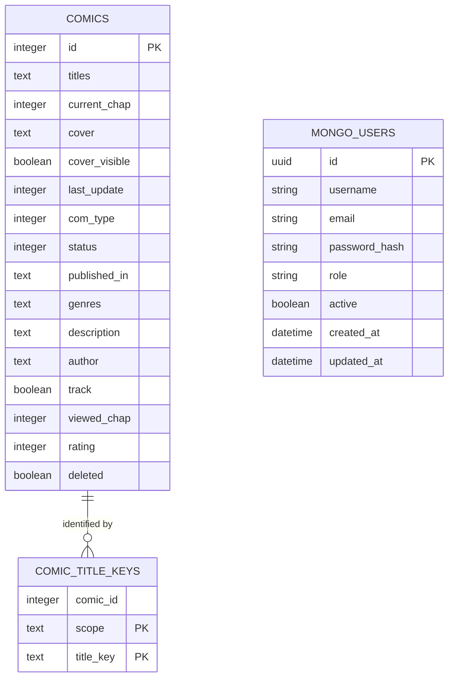
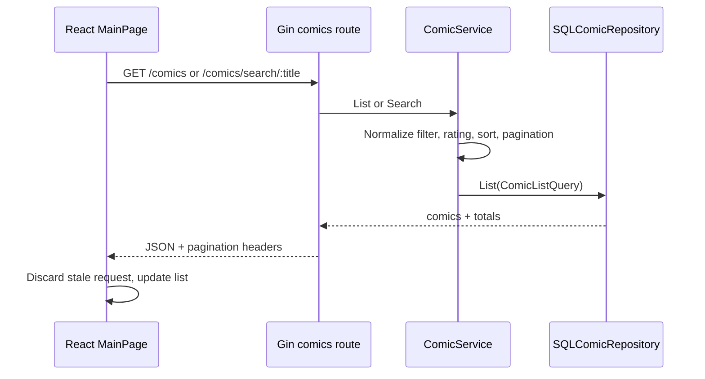
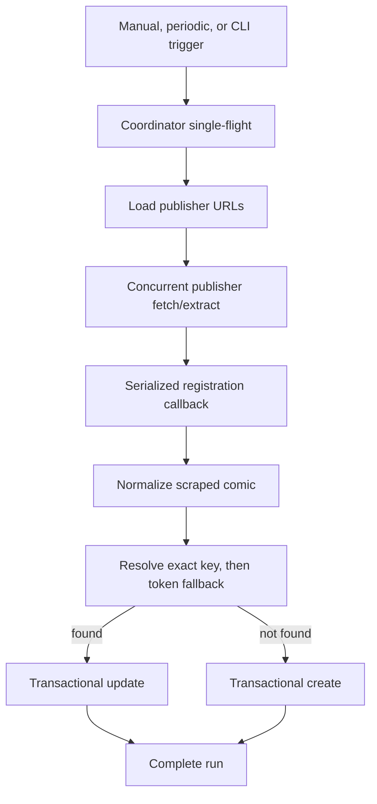
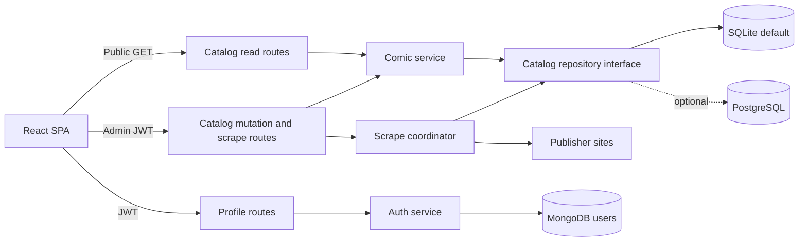

# Comics Architecture Review and Hardening Design

**Status:** Approved design  
**Date:** 2026-10-26  
**Scope:** React application, Go services, data stores, scraper, algorithms, and operations

## Executive Summary

The application is a React 19 single-page app backed by a Go/Gin modular
monolith. The Go process owns REST delivery, JWT/OAuth profile flows, catalog
use cases, publisher scraping, and periodic scheduling. Catalog data uses
SQLite by default with an optional PostgreSQL adapter. User and authentication
data uses MongoDB.

This design keeps SQLite + MongoDB as the default deployment and retains
PostgreSQL as an optional catalog backend. It does not introduce Redis or split
the application into microservices. The redesign strengthens route
authorization, catalog invariants, transaction boundaries, lifecycle handling,
scrape reporting, frontend consistency, database parity, and operational
documentation.

Two verified issues drive the highest-priority work:

1. Every catalog mutation and `/scrape` is currently public.
2. The live SQLite catalog has 346 active comics without discovery keys because
   title-key conflicts are silently ignored.

The target security model is public catalog reads with authenticated,
admin-only catalog writes and scrape triggers.

## Decisions

- Keep the Go modular monolith as the production service.
- Keep React + REST JSON as the production client contract.
- Keep SQLite as the default catalog store and explicitly document its
  single-instance constraint.
- Keep MongoDB as the user/auth store.
- Keep PostgreSQL as an optional catalog backend and scale-up path.
- Make public catalog reads explicit.
- Require an admin JWT for create, update, delete, merge, cover mutation, and
  manual scrape operations.
- Make discovery-key conflicts explicit and transactional.
- Treat gRPC and generated protobuf clients as non-production until either
  brought to parity or retired.
- Put the complete architecture and roadmap summary in the root README.
- Put executable, test-driven implementation detail in separate plan files
  linked from the README.

## Audit Method and Limits

The review used source inspection, tests, build/deploy configuration, generated
schema files, and read-only SQLite introspection. On 2026-10-26:

- `PRAGMA integrity_check` returned `ok`.
- `comics` contained 31,309 rows, of which 31,308 were active.
- `comic_title_keys` contained 31,892 rows.
- 346 active comics had no `comic_title_keys` row.
- No orphan title-key rows were present.

A generated code graph was used for navigation, not as sole evidence. Its
health report found 984 dangling endpoint edges and 131 collapsed undirected
edges, mostly around generated code and external symbols. Critical findings in
this design were therefore verified against source or read-only SQL.

## Current Architecture

### Runtime Components

| Component | Responsibility | Primary source |
|---|---|---|
| React SPA | Routing, catalog UI, filters, pagination, mutations, profile UI | `src/frontend/` |
| Go HTTP entrypoint | Process lifecycle, scheduler, Gin startup | `go_server/cmd/server/main.go` |
| Route layer | REST binding, middleware, CORS, health, auth policy | `go_server/api/route/` |
| Use cases | Catalog, auth, user, merge, and scrape orchestration | `go_server/internal/usecase/` |
| Catalog repository | SQLite/PostgreSQL CRUD, transactions, discovery keys | `go_server/internal/repo/comics/` |
| User repository | MongoDB user persistence | `go_server/internal/repo/mongo/` |
| Discovery | Title normalization, key lookup, fuzzy candidate ranking | `go_server/internal/identity/`, `go_server/internal/discovery/` |
| Scraper | Fetch, publisher extraction, normalization, registration | `go_server/internal/scrape/` |
| Operations | Make, Docker, Render, GitHub Actions, backup/restore | `Makefile`, `Dockerfile`, `.github/`, `docs/deploy-render.md` |

### Current Route Boundary

`route.Setup` mounts OAuth, health, metrics, all comic routes, scrape routes,
signup, login, and refresh on the public router. Only profile routes use JWT
authentication, and only the dashboard uses the admin role middleware.

Current public catalog routes include:

- `GET /comics`
- `GET /comics/:id`
- `GET /comics/search/:title`
- `POST /comics`
- `PUT /comics/:id`
- `DELETE /comics/:id`
- `PATCH /comics/:id/cover-visibility`
- `PATCH|PUT /comics/:id/:merging_id`
- `GET /scrape`
- `GET /scrape/status`

### Current Data Ownership

SQLite's runtime-created `comic_title_keys` table does not currently declare a
foreign key. PostgreSQL declares `comic_id REFERENCES comics(id) ON DELETE
CASCADE`. The composite primary key `(scope, title_key)` permits only one key
owner, but the current insert uses `INSERT OR IGNORE`/`ON CONFLICT DO NOTHING`.
It therefore prevents duplicate key rows while still allowing keyless duplicate
comic rows.

The SQLite `users` table is legacy and empty in the reviewed database. MongoDB
is the only user store wired by `bootstrap.MustLoadApp`.

## Current Critical Flows

### Catalog Read

The frontend debounces search, cancels superseded requests, and refreshes every
three minutes while visible and online. Pagination is offset-based. The
viewport-derived page limit can change without resetting the offset.

### Catalog Create or Update

Create normalizes title variants and calls the discovery resolver before
inserting. Update applies a patch but does not normalize edited titles or
re-run duplicate detection. Repository `Create` and `Update` persist the comic
and then synchronize discovery keys as a second operation unless the caller has
already opened a transaction.

This means REST create/update can commit a comic and fail before key
synchronization. Scrape registration is safer because it wraps resolve and
create/update in `WithTx`.

### Merge

`ComicService.Merge` opens a catalog transaction, reads both comics, combines
titles/publishers/genres, keeps maximum progress/rating, updates the canonical
row, and deletes the duplicate row. The merge is atomic, but merged titles are
not normalized before discovery keys are rebuilt.

### Scrape

Publisher fetches run concurrently except configured sequential publishers.
Registration is serialized by a process-local mutex. Per-publisher failures are
logged and suppressed, so `RunAll` can return success even when every publisher
failed. Coordination is process-local and therefore only correct for one API
replica.

### Authentication

Login validates a MongoDB user password and issues HMAC-signed access and
refresh JWTs. Profile routes validate the access token. The React app stores
the access token in `sessionStorage`; catalog requests currently send no token.
Google OAuth uses process-global state and does not verify `verified_email`.

### Deployment and Recovery

- The root Docker image runs the Go server as a non-root user.
- Render maps platform `PORT` and requires a persistent `/data` disk for
  SQLite.
- Root Docker Compose mounts `./db` to `/data` and starts MongoDB without a
  persistent Mongo volume.
- GitHub CI runs Go and frontend tests/build/lint, but not the repository's
  contract-test target.
- The SSH deployment workflow does not gate deployment on CI, take a catalog
  backup, or verify `/ready` after deployment.
- `make db-backup` creates a timestamped SQLite `.db` backup.
- `make db-restore` copies a selected `.db` file over `db/comics.db`; it must not
  run while the API is writing.
- `db/comics.json` is not used by the current Go runtime or backup targets.

## Algorithm Inventory

### Identity Normalization

`NormalizeTitleVariants` strips novel markers, applies sentence-case storage,
deduplicates case-insensitively, and preserves order. `TitleMatchKey` lowercases,
removes a leading article, and removes non-ASCII-alphanumeric characters.
Discovery keys add `series` or `novel` scope.

- Complexity: O(total title characters).
- Deterministic: yes.
- Risk: ASCII-only match keys and broad single-token subset matching can create
  false equivalence.

### Discovery Resolution

`ResolveComic` first queries indexed title keys. If no candidate wins, it picks
one significant word and queries up to 200 keys with `%token%`. Candidates are
filtered by exact key, prefix, or significant-token relationship and scored:

- exact normalized key: +10
- exact stored text ignoring case: +5
- significant-token relation: +8
- prefix relation: +6
- tracked comic: +2
- current chapter: `current_chap / 100`
- equal score: lower comic ID
- minimum accepted score: 6

The indexed path is bounded by input variants. The fallback can scan a broad
part of `comic_title_keys` and evaluate up to 200 candidates.

### Discovery-Key Synchronization

`SyncDiscoveryKeys` deletes every key for a comic and reinserts unique scoped
keys for all title variants.

- Complexity: O(title variants).
- Current failure mode: conflicting inserts are silently ignored.
- Current repair limitation: startup backfill only runs when the entire key
  table is empty, so partial/keyless state remains.

### Dedupe Planning

`cmd/dedupe` audits title-key collision groups, chooses the lowest ID as
canonical, exports an unapproved review plan, and applies only approved merges.
Because the unique key index hides loser rows, it reports zero collision groups
for the reviewed live database even though 346 active rows have no keys. The
current Go planner does not calculate the chapter-spread/ratio signals described
in older workspace documentation.

### Merge

Merge unions string/integer collections, selects maximum progress/rating,
preserves non-empty metadata, updates the canonical row, and hard-deletes the
duplicate in one transaction.

- Complexity: O(total merged collection size).
- Deterministic: yes for a fixed base and duplicate ordering.
- Risk: unnormalized merged titles and permissive unknown-type merging.

### Scrape Concurrency

Publisher URLs are grouped by publisher. Most URLs fetch concurrently;
cookie-sensitive publishers run sequentially. All writes pass through one
registration mutex, and each comic registration uses one database transaction.

- Fetch complexity: proportional to publisher URLs and listing entries.
- Write concurrency: effectively serial.
- Failure mode: errors are logged but omitted from the result.

### List, Search, and Pagination

The server validates offset, limit (maximum 100), rating bounds, and sort
columns. List indexes support active/update and tracked/update access patterns.
Title search uses `%term%` on pipe-delimited title text and can scan the table.
The frontend calculates page size from viewport columns and estimated rows.

### JWT and Passwords

Passwords use bcrypt. Access and refresh tokens use HMAC JWTs with separate
secrets and expirations. Role is stored in the subject claim. Tokens are
stateless; revocation and rotation are not currently modeled.

## Findings by Priority

### P0: Security and Data Integrity

1. Public users can create, update, delete, merge, change cover visibility, and
   trigger a potentially expensive scrape.
2. Silent title-key conflict handling leaves active comics without keys. The
   reviewed database contains 346 such rows.
3. Update does not normalize edited titles or check whether they resolve to
   another comic.

### P1: Reliability and Correctness

1. REST create/update and discovery-key synchronization are not atomic.
2. Scrape reports success after partial or total publisher failure.
3. Process shutdown closes repositories without gracefully draining HTTP
   requests or waiting for an active scrape.
4. Production health checks use liveness rather than datastore readiness.
5. MongoDB uniqueness is not established programmatically for username/email.
6. OAuth state and verified-email handling are not production-safe.
7. The default SQLite architecture is incompatible with multiple API replicas.

### P2: Operations and Maintainability

1. SQLite and PostgreSQL schema/migration paths are not fully unified.
2. The production REST repository and separate gRPC repository have divergent
   models and behavior.
3. Frontend mutations can fail silently or update card-local state without
   invalidating the list.
4. The SSH deployment path has no backup, readiness verification, or explicit
   CI dependency.
5. Root Compose does not persist MongoDB data.
6. Metrics, Swagger, and signup are public without an explicit threat model.

### P3: Cleanup

1. Python-era environment/documentation references remain.
2. Frontend protobuf bindings are generated but unused by the REST app.
3. The gRPC binary is not part of the main runtime but remains easy to mistake
   for a supported production path.
4. `db/comics.json`, legacy SQLite users, and duplicate schema artifacts make
   ownership unclear.

## Target Architecture

### Route Policy

- Public: health/liveness, readiness as appropriate, catalog list/get/search,
  login, refresh, and OAuth entry/callback.
- Authenticated user: profile read/update.
- Admin: catalog create/update/delete/merge/cover mutation, scrape trigger and
  operational scrape status.
- Metrics and Swagger: disabled, protected, or network-restricted in
  production.

### Catalog Invariants

1. Every active comic has at least one valid discovery key.
2. One `(scope, title_key)` has exactly one owner.
3. A key conflict returns a typed conflict; it is never silently discarded.
4. Comic row and key changes commit or roll back together.
5. Every create, update, merge, import, and scrape path applies the same title
   normalization and duplicate policy.
6. Deleted comics do not retain keys that block active records.
7. SQLite and PostgreSQL pass the same repository contract suite.

### Deployment Invariants

1. SQLite mode runs exactly one API replica and one periodic scheduler.
2. PostgreSQL mode may scale the API only after scrape coordination uses a
   database-backed lease/advisory lock.
3. `/health` is process liveness; `/ready` checks MongoDB and catalog
   connectivity and gates traffic/deployment success.
4. Shutdown stops accepting requests, cancels scheduling, drains active HTTP
   requests, and waits a bounded time for scrape work before repositories close.
5. A verified catalog backup exists before destructive schema/data repair.

## Improvement Workstreams

### 1. Security Boundary

Move catalog reads and mutations into separate route groups, apply JWT + admin
role middleware to all mutation and scrape routes, and teach the frontend API
client to attach access tokens.

- Pros: closes the public mutation/DoS surface with existing auth machinery.
- Cons: expired sessions become visible in catalog workflows and require
  explicit UX.

### 2. Discovery and Data Integrity

Export a repair plan for every keyless comic, classify conflict owners, merge
only approved groups, normalize all write paths, replace silent inserts with
typed conflicts, and enforce active-record key ownership.

- Pros: restores discoverability and prevents recurrence.
- Cons: historical collisions need human review; key semantics changes require
  a full rehearsal and backup.

### 3. Transactional Repository and Schema Parity

Wrap REST create/update with transactions, add SQLite foreign-key/cascade
support through an offline migration, unify migration locations, and run one
contract suite against both SQLite and PostgreSQL.

- Pros: removes partial writes and dialect drift.
- Cons: SQLite schema rebuild requires maintenance time.

### 4. Lifecycle and Operations

Use `http.Server` for graceful shutdown, point platform checks at `/ready`, gate
deployment on CI, add backup/readiness/rollback stages, persist or externalize
MongoDB, and document single-instance SQLite constraints.

- Pros: safer deploys and recovery.
- Cons: longer deploy workflow and bounded shutdown delay.

### 5. Scrape Reliability

Return structured per-publisher results, distinguish partial/total failure,
retry only transient fetch errors with capped backoff, expose status/history,
and define process-local coordination for SQLite versus advisory locking for a
future scaled PostgreSQL deployment.

- Pros: observable freshness and fewer silent failures.
- Cons: more status types and tests; retries increase scrape duration.

### 6. Authentication Hardening

Create unique Mongo indexes, enforce active users, replace global OAuth state
with per-session expiring state, verify Google email ownership, define refresh
rotation/revocation behavior, and remove role trust from client-provided data.

- Pros: closes account and OAuth integrity gaps.
- Cons: session migration may sign existing users out.

### 7. Frontend Consistency

Add one typed API client, standardized response/error parsing, bearer injection,
global unauthorized handling, mutation feedback, list invalidation, and offset
reset when page size changes.

- Pros: removes silent failures and card/list drift.
- Cons: touches most network call sites.

### 8. Contract and Legacy Cleanup

Confirm whether any gRPC consumer exists. Either bring gRPC onto the same use
case/repository/auth path or remove it. Remove unused protobuf/Python
configuration and reconcile generated schemas with the supported REST runtime.

- Pros: one understandable production architecture.
- Cons: removal is breaking if an unknown consumer exists.

### 9. Observability and Verification

Add security-denial, discovery-conflict, keyless-comic, scrape-outcome,
readiness, and shutdown metrics. Add route-policy, repository contract,
migration, scrape failure, and frontend mutation integration tests.

- Pros: makes every other workstream measurable and regression-resistant.
- Cons: added CI and telemetry maintenance.

## Alternatives Considered

### PostgreSQL-Only Modular Monolith

Using PostgreSQL for comics and users would simplify transaction and scaling
semantics, but requires replacing Mongo auth persistence and forces a migration
not currently required by product scale. Rejected as the immediate target.

### API + Dedicated Worker + Redis

A queue-backed scrape worker offers strong isolation and distributed retries,
but adds another stateful service and operational cost. Rejected until measured
scrape load or API availability requires it.

### Preserve Public Mutations

This avoids frontend auth work but leaves destructive and expensive operations
open to the internet. Rejected.

### Put Every Implementation Step in README

This would satisfy a literal single-file interpretation but make onboarding and
operations unreadable. Rejected in favor of a complete README summary linked to
workstream plans.

## Error-Handling Design

- Domain errors are typed and mapped to stable public error codes.
- Internal database/fetch errors are logged with request/scrape correlation IDs
  but are not returned verbatim.
- Discovery conflict responses include the owning comic ID for authorized admin
  clients.
- Scrape responses distinguish accepted/running, complete, partial failure,
  total failure, and canceled.
- Frontend mutations update local state only after `response.ok` and validated
  payloads.
- Backup/repair commands stop before destructive work when prerequisites fail.

## Testing Strategy

- Unit tests: identity normalization, resolver score matrix, merge semantics,
  retry classification, route policy.
- Repository contract tests: create/update/delete/merge/key conflict against
  SQLite and PostgreSQL.
- Migration tests: representative pre-title-key SQLite fixture to target schema.
- Integration tests: public reads, unauthorized mutations, admin mutations,
  scrape conflict/status, graceful cancellation.
- Frontend tests: token injection, 401 handling, mutation errors, invalidation,
  resize pagination.
- Operational smoke: container starts, `/health` lives, `/ready` gates, one
  authorized catalog mutation round trip, backup verification.

## Documentation Deliverables

The root README will contain:

1. Current and target topology diagrams.
2. Component and ownership map.
3. SQLite/PostgreSQL/Mongo schema description and ER diagram.
4. Catalog read/write, auth, scrape, deployment, backup, and recovery flows.
5. Algorithm inventory with invariants and edge cases.
6. Current critical risks.
7. Target route/security and deployment policies.
8. Improvement roadmap with pros/cons.
9. Links to nine executable implementation plans.

A Cursor canvas will provide a durable visual review companion. The README
remains the version-controlled source of truth.

## Acceptance Criteria

- The README distinguishes verified current state from approved target state.
- Every diagram matches current code or is labeled target.
- All current Make commands in the README exist.
- Backup/restore documentation matches SQLite `.db` behavior.
- The 346 keyless-comic finding and non-destructive review requirement are
  documented.
- Each improvement workstream has its own implementation plan with exact files,
  tests, commands, migration/rollback steps, dependencies, and commits.
- Plans preserve SQLite + Mongo as default and PostgreSQL as optional.
- Security plans preserve public reads and require admin authorization for all
  catalog mutations and scrape triggers.
- No plan assumes horizontal scaling in SQLite mode.
- The architecture canvas and README show the same boundaries and flows.
